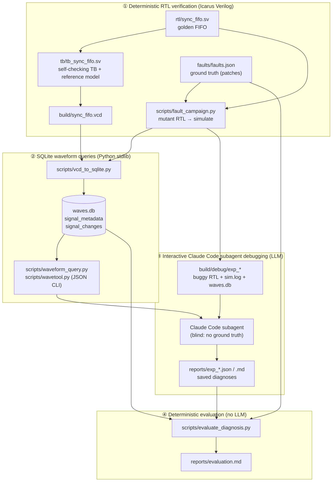

# AI-Assisted RTL Debugger

A small, reproducible proof of concept for **AI-assisted root-cause analysis
of RTL bugs from simulation waveforms**. A synchronous FIFO is verified with
a self-checking SystemVerilog testbench. Its VCD waveform is converted into a
queryable SQLite database. An AI coding agent (Claude Code) then diagnoses
injected RTL faults *blind*, using only waveform queries, the simulation log
and the RTL source. Its saved reports are scored deterministically against
hidden ground truth.

> **Independent, simplified re-implementation.** This project is inspired by
> *"Back to the Future: Rethinking EDA Infrastructure for Agentic Systems in
> Chip Design Verification"* (BTTF) by Je Yang (Columbia University; work done
> while interning at Google), Ivan Lobov (Google DeepMind) and Thomas Karpati
> (Google), [arXiv:2610.06790](https://arxiv.org/abs/2610.06790), NeurIPS'26
> Workshop on AI for Chip Design. It is **not** Google's implementation and
> uses no code from the paper. It reproduces only the core idea at toy scale:
> distill a waveform dump into a normalized SQLite database, then let an agent
> investigate through schema-aware query tools.

## Contents

- [Motivation](#motivation)
- [Architecture](#architecture)
- [Technology stack](#technology-stack)
- [Repository structure](#repository-structure)
- [Setup](#setup)
- [Quick start](#quick-start)
- [1. FIFO verification methodology](#1-fifo-verification-methodology)
- [2. VCD-to-SQLite workflow](#2-vcd-to-sqlite-workflow)
- [3. Fault injection experiments](#3-fault-injection-experiments)
- [4. AI-assisted waveform debugging workflow](#4-ai-assisted-waveform-debugging-workflow)
- [5. Evaluation results](#5-evaluation-results)
- [Known limitations](#known-limitations)
- [Future work](#future-work)

## Motivation

Debugging a failing simulation usually means a person scrolling through
waveforms. Raw dumps are huge, unstructured text, which suits neither people
nor LLMs. BTTF argues that the infrastructure, not just the model, should
change: preprocess waveforms into a relational store and give agents precise
query tools. This repository checks that idea on a design small enough to
verify every step by hand.

## Architecture

The four layers are kept strictly separate. Only one of them involves an LLM.



| Layer | What runs | LLM? | Make target |
|---|---|---|---|
| ① RTL functional verification | Icarus Verilog simulation, self-checking TB | No | `make test`, `make fault-test` |
| ② Waveform database and queries | VCD → SQLite conversion, read-only query tools | No | `make db`, `make db-test`, `make debug-data` |
| ③ AI debugging | Claude Code subagents, run interactively | **Yes** | *(manual, see §4)* |
| ④ Evaluation | Scores the **saved** AI reports against ground truth | No | `make eval` |

## Technology stack

| Area | Tools |
|---|---|
| RTL and testbench | SystemVerilog (Icarus-compatible subset), Icarus Verilog 10.3 (`-g2012`) |
| Waveforms | VCD; GTKWave (optional) for viewing |
| Lint (optional) | Verilator 4.028, `--lint-only -Wall` |
| Waveform database | Python 3.8 standard library: `sqlite3` (SQLite 3.31), `argparse`, `json` |
| Tests | Python `unittest` (no third-party packages) |
| Build | GNU Make |
| AI agent | Claude Code (interactive session with subagents; no separate API key) |
| Platform tested | Ubuntu 20.04.6 LTS, x86_64 |

**What this project does not use:** UVM, SystemVerilog assertions (SVA),
formal verification, constrained-random stimulus, coverage-driven closure,
cocotb, or a standalone LLM API service.

## Repository structure

```
.
├── rtl/sync_fifo.sv              # golden synchronous FIFO (WIDTH=8, DEPTH=8)
├── tb/tb_sync_fifo.sv            # self-checking directed testbench + reference model
├── waves/sync_fifo.gtkw          # GTKWave signal layout
├── scripts/
│   ├── vcd_to_sqlite.py          # streaming VCD parser → SQLite (waves.db)
│   ├── waveform_query.py         # find_signal / get_value_at_time / get_signal_history
│   ├── wavetool.py               # read-only JSON CLI for agents (--exp / --db)
│   ├── fault_campaign.py         # build mutants, simulate, check activation, make bundles
│   └── evaluate_diagnosis.py     # deterministic scoring of saved AI reports
├── tests/
│   ├── test_waveform_query.py    # 36 tests, cross-checked against an independent VCD reader
│   ├── test_wavetool.py          # 5 CLI tests
│   └── fixtures/mini.vcd         # hand-written VCD (X/Z, real, aliases, $dumpoff)
├── faults/faults.json            # injected-fault ground truth (hidden from the agent)
├── reports/                      # saved AI diagnoses (exp_*.md/json) + evaluation.*
├── docs/
│   ├── fifo_spec.md              # FIFO specification
│   ├── milestone2_report.md      # waveform database design and results
│   ├── milestone3_report.md      # fault injection + AI debugging (contains ground truth)
│   ├── m3_agent_prompt.md        # reusable blind-debugging prompt
│   └── resume_bullets.md
└── Makefile
```

Generated outputs (`build/`: VCDs, SQLite databases, compiled simulations,
logs, debug bundles) are not committed. They are regenerated by `make`.

## Setup

Requirements (all were available on stock Ubuntu 20.04; nothing needs to be
installed with pip):

```bash
sudo apt install iverilog make python3     # required
sudo apt install gtkwave verilator         # optional: waveform viewer, lint
```

- Icarus Verilog 10.3 or newer, with SystemVerilog 2012 mode
- Python 3.8 or newer (standard library only)
- Claude Code (Anthropic's agentic coding CLI), only to re-run the
  interactive AI-debugging step

## Quick start

```bash
git clone https://github.com/maomaoytxiao/AI-Assisted-RTL-Debugger.git
cd AI-Assisted-RTL-Debugger

make test         # 8 directed FIFO tests (Icarus), writes build/sync_fifo.vcd
make db           # VCD → build/waves.db
make db-test      # 41 Python tests for the database and query tools
make fault-test   # golden + 3 injected faults: activation + detection
make debug-data   # agent-visible bundles in build/debug/exp_{a,b,c}
make eval         # score the saved AI reports in reports/ (no LLM is run)

make wave         # optional: open the golden waveform in GTKWave
make lint         # optional: Verilator lint of the RTL
make clean        # remove build/
```

Example waveform queries (JSON output):

```bash
python3 scripts/wavetool.py find "dut.*_ptr"
python3 scripts/wavetool.py value dut.count 100ns
python3 scripts/wavetool.py history dut.full 100ns 250ns
python3 scripts/wavetool.py --exp exp_b value dut.rd_ptr 436000
```

## 1. FIFO verification methodology

**Design** (`rtl/sync_fifo.sv`, spec in `docs/fifo_spec.md`):
- 8×8-bit synchronous FIFO.
- Active-low reset, asserted asynchronously and released synchronously.
- `full`, `empty` and `count` flags, plus combinational `overflow` and
  `underflow` indicators.
- Registered `rd_data` with 1-cycle read latency.
- Pointers carry an extra wrap bit.
- Simultaneous read/write: when the FIFO is empty only the write is accepted
  (no fall-through); when full, only the read is accepted.

**Testbench** (`tb/tb_sync_fifo.sv`): a self-checking directed testbench
with a cycle-accurate reference model.
- Inputs change on the falling clock edge.
- `full`, `empty`, `count`, `overflow` and `underflow` are checked before
  each rising edge.
- `rd_data`, `count` and the flags are checked after it.
- 8 directed tests: reset, fill, drain, overflow requests, underflow requests,
  pointer wraparound, simultaneous read/write (empty, partly full, full,
  streaming), and reset during operation.
- Each run prints per-test PASS/FAIL and an overall `TEST PASSED` or
  `TEST FAILED`.

**Waveform:** the VCD includes the interface signals, the internal pointers,
the internal accept signals (`wr_fire`/`rd_fire`) and the memory words.

## 2. VCD-to-SQLite workflow

`scripts/vcd_to_sqlite.py` streams the VCD token by token. Memory use is
bounded by the number of signals, not the length of the waveform. It writes:

| Table | Contents |
|---|---|
| `signal_metadata` | `signal_id`, `hierarchical_name`, `scope`, `name`, `width`, `bit_range`, `signal_type`, `scope_type`, `vcd_identifier`, `alias_of`, `change_count` |
| `signal_changes` | `change_id` (VCD event order), `signal_id`, `timestamp` (VCD ticks), `value` |
| `waveform_info` | timescale, signal and event counts, start and end times |
| `v_signal_changes` (view) | changes addressable by any hierarchical name, aliases included |

- **Value changes, not per-cycle samples.**
- **Full-width binary values** with X and Z kept bit for bit. Shortened
  vectors are extended per IEEE 1364.
- **Aliases stored once.** When the VCD reuses one identifier for several
  names (e.g. `tb.clk` and `dut.clk`), the changes are stored once and the
  other names point to them through `alias_of`.
- **Fast loading and lookup.** Rows are inserted in batches with
  `executemany`, and the indexes are built after the load.
- **Atomic writes.** The database is built in a temporary file and renamed
  into place.

The query tools are parameterized and read-only (`mode=ro`,
`PRAGMA query_only`). They accept times in ticks or with units (`"135ns"`),
resolve names by exact or dotted-suffix match, and reject ambiguous names
with a list of candidates instead of guessing.

The tests cross-check every signal's full history, and values around every
change, against an **independent** VCD reader in the test file. They also
check design invariants through the API, for example `full == (count == 8)`.
See `docs/milestone2_report.md`.

## 3. Fault injection experiments

`faults/faults.json` holds three single-site RTL faults as text patches. They
are applied to copies of the golden RTL; the golden file is never modified.
Experiment ids are neutral and shuffled.

| Experiment | Injected fault |
|---|---|
| exp_c | Write pointer advances when the FIFO is full (`if (wr_en)` instead of `if (wr_fire)`) |
| exp_b | Read pointer advances when the FIFO is empty (`rd_ptr` update gated by `rd_en`) |
| exp_a | Full flag asserts at 7 entries (off by one, ignores the pointer wrap bit) |

For each mutant, `make fault-test`:
1. runs the unchanged testbench;
2. saves the log, VCD and SQLite database;
3. confirms **activation** from the waveform database, independently of the
   testbench. For example: "a pointer changed on an edge where request = 1
   and full/empty = 1".

The golden design is run as a control and must pass with zero activations.

## 4. AI-assisted waveform debugging workflow

This is the only step that uses an LLM, and it is **interactive**. It is not
run by `make`.

1. `make debug-data` creates `build/debug/exp_*`. Each bundle contains only
   the buggy RTL, `sim.log`, `waves.db` and a neutral README.
2. In a Claude Code session started at the repository root, start one
   subagent per experiment, or a fresh `claude` session each time, with the
   prompt in [`docs/m3_agent_prompt.md`](docs/m3_agent_prompt.md).
   Substitute `{EXP}` and `{REPO}`.
3. The agent finds the first failure in `sim.log` and queries signals with
   `scripts/wavetool.py`. It inspects pointers, flags and control signals
   before and after the failure, reads the RTL, and writes
   `reports/<exp>.json` (structured: first failure, root-cause file, line
   and signal, cited evidence) and `reports/<exp>.md`.
4. `make eval` scores the saved reports.

**How the agent is kept blind.** The ground truth stays in the repository
for reproducibility. It is kept away from the agent in four ways:
- **No answers in the prompt.** The prompt contains no fault descriptions,
  fault classes or expected answers.
- **Neutral, shuffled names.** Experiment ids such as `exp_a` give no hint
  of the fault.
- **Minimal bundles.** Each bundle holds only what a debugging engineer
  would have.
- **Explicit off-limits list.** The prompt forbids the ground truth, the
  golden RTL and golden waveform, the campaign and evaluation scripts, other
  bundles and reports, and git.

This is enforced by instruction, not a sandbox. For the recorded run, every
tool call in the three agents' transcripts was audited afterwards (26 shell
commands and 1 file write in total). No off-limits path was accessed. That
audit was a one-off check inside the Claude Code session; its script is not
part of this repository.

**Evidence integrity.** `make eval` re-runs every waveform query an agent
cites and requires an exact match. An invented value fails the evaluation.

## 5. Evaluation results

Final regression from `make clean` on Ubuntu 20.04 (Icarus Verilog 10.3,
Python 3.8.10):

| Check | Result |
|---|---|
| FIFO directed tests (`make test`) | **8 / 8 passed**, 1 994 checks, 0 errors |
| Waveform database (`make db`) | 64 signals (56 nets + 8 aliases), 4 787 value changes, 381 KB |
| Python tests (`make db-test`) | **41 / 41 passed** |
| Faults injected / activated / detected by TB (`make fault-test`) | **3 / 3 / 3**; golden control: passed, 0 false activations |
| Correct AI diagnoses (`make eval`) | **3 / 3** (file, line and signal all match) |
| AI-cited waveform evidence reproduced from the database | **51 / 51** |
| First failure (time and cycle) correctly identified | 3 / 3 |

| Exp | First failure (ps, cycle, test) | Agent's root cause | Verdict |
|---|---|---|---|
| exp_a | 126000, 13, `fill` | `sync_fifo.sv:54`, `full` asserts at 7 entries | Correct |
| exp_b | 436000, 44, `underflow` | `sync_fifo.sv:71`, `rd_ptr` advances on `rd_en` | Correct |
| exp_c | 326000, 33, `overflow` | `sync_fifo.sv:67`, `wr_ptr` advances on `wr_en` | Correct |

**`make eval` does not run an LLM.** It scores the AI reports saved in
`reports/`, which were produced earlier by the interactive Claude Code step.
Re-running the AI step may give different wording or evidence. The full
reports are in [`reports/`](reports/), and the evaluation is in
[`reports/evaluation.md`](reports/evaluation.md).

## Known limitations

- **Scale.** A tiny design (one 8-entry FIFO, about 100 lines of RTL), three
  single-site faults and 64 signals. This shows the workflow end to end; it
  does not measure accuracy statistically.
- **Easy faults.** Each fault produces a testbench error one clock edge
  after activation, in a very readable log. Bugs spread across several
  sites, intermittent bugs or latent bugs were not tested.
- **Manual AI step.** The LLM step is run by hand in Claude Code and is not
  automated by `make`. A fully automated loop (API tool calling or headless
  CLI runs) is not implemented.
- **Blindness is not sandboxed.** It relies on instructions plus a one-off
  transcript audit.
- **Same model family.** The faults were written and diagnosed by models
  from the same family, though the diagnosing agents had fresh contexts.
- **Strict scoring.** Accepted lines and signals are fixed, so a correct
  diagnosis that cites an adjacent line would be scored as incorrect.
- **Limited verification methodology.** Directed tests only: no
  constrained-random stimulus, functional coverage, SVA or formal
  verification, and no UVM.
- **Database format limits.** VCD only (no FSDB). Values are stored as
  binary text. The database is about 5.8× the size of this small VCD.
  Redundant same-value events written by the simulator are kept as recorded.

## Future work

- Automate the agent loop (for example headless Claude Code runs or API
  tool calling) and repeat each experiment several times to measure
  variance.
- A larger fault set (multiple sites, data-path, reset and timing-related
  faults) and larger designs.
- More query tools in the style of BTTF: toggle counts that skip
  same-value events, first time a signal has a value, scope-level coverage,
  X-propagation checks.
- BTTF-style pruning (clocks, signals that never change) and a more compact
  value encoding.
- Constrained-random stimulus with functional coverage, and SVA once a
  simulator that supports it is available.
- Re-simulate the agent's proposed fix to confirm a diagnosis
  automatically.

## Acknowledgements

The concept is based on the BTTF paper by Je Yang, Ivan Lobov and Thomas
Karpati (arXiv:2610.06790). All code in this repository was written
independently for this proof of concept, with AI assistance from Claude Code.
